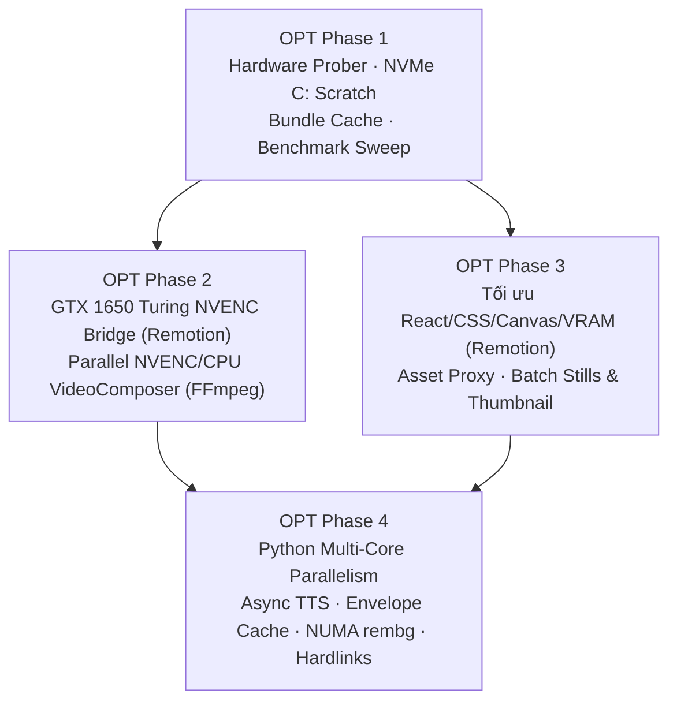

# KẾ HOẠCH TỐI ƯU HÓA HIỆU NĂNG PHẦN CỨNG — CINESTORY ENGINE

*(Mã tài liệu: PLAN_HW_OPT_MASTER · rev 1 · 2026-11-19)*  
*(Thiết kế chuyên biệt cho cấu hình máy thực tế đã đo kiểm trực tiếp)*

---

## 1. HỒ SƠ PHẦN CỨNG THỰC TẾ ĐÃ KIỂM CHỨNG

| Thành phần | Thông số thực tế trên máy | Đặc tính hiệu năng & Ràng buộc cần lưu ý |
| :--- | :--- | :--- |
| **CPU** | **2× Intel Xeon E5-2680 v4 @ 2.40 GHz** (Broadwell-EP, 2 socket NUMA) — **28 nhân vật lý / 56 luồng logic** | Xung đơn nhân thấp (2.4 GHz base), nhưng **băng thông đa luồng cực lớn**. Code tuần tự 1 luồng sẽ rất chậm; song song hóa đa tiến trình/đa luồng cho mức tăng tốc vượt trội. Cần tránh cross-NUMA thrashing (đặc biệt với ONNX Runtime / `rembg`). |
| **RAM** | **64 GB** (63.91 GB thực dụng) | Dư dả để chạy 16–28 tab Chromium song song, giữ cache media lớn trong RAM (`mediaCacheSizeInBytes`), và chạy nhiều worker Python cùng lúc mà không swap. |
| **GPU** | **NVIDIA GeForce GTX 1650 (PCI `0x1F0A`, TU106 GDDR6, 4 GB VRAM)** · Driver `610.88` | Đã kiểm chứng trực tiếp bằng FFmpeg: hỗ trợ **`h264_nvenc` + Turing B-frames (`-bf 2`)** (`EXIT=0`). **Giới hạn quan trọng:** chỉ có **4 GB VRAM** và giới hạn số phiên NVENC đồng thời của card GeForce → không mở quá 3–4 phiên encode NVENC song song và phải kiểm soát VRAM texture khi nhiều tab Chromium cùng dùng ANGLE. |
| **Ổ đĩa `C:`** | **`WDBGMP0010BNC-WRSN` — NVMe SSD 930.8 GB** (trống **530.8 GB**) | Tốc độ đọc/ghi ngẫu nhiên và tuần tự cực nhanh — lý tưởng cho scratch/temp, Webpack bundle cache, file trung gian `prenorm.mkv`, `clips/*.mov`. |
| **Ổ đĩa `D:`** | **`WD My Book 25DA` — Ổ cứng ngoài USB HDD 1.86 TB** (trống 806.8 GB) — **đang chứa repo `D:\_Short_film`** | **Nút thắt I/O ẩn cực lớn!** Mọi thao tác đọc `node_modules`, bundle Webpack, ghi/đọc `video.prenorm.mkv` (chứa PCM không nén) và `clips/*.mov` trực tiếp lên USB HDD đều bị nghẽn băng thông & độ trễ seek. |
| **FFmpeg hệ thống** | `C:\Program Files\ffmpeg-master-latest-win64-gpl-shared\bin\ffmpeg.exe` (`N-121008`, build `2025-09-07`) | Đầy đủ `h264_nvenc`, `hevc_nvenc`, `cuda`, `d3d11va`, `vulkan`, `libx264`. Dùng bộ DLL **`avcodec-62` / `avutil-60` / `avformat-62`**. |
| **FFmpeg nội bộ Remotion** | `remotion\node_modules\@remotion\compositor-win32-x64-msvc\ffmpeg.exe` (`n7.1`) | **Chỉ có duy nhất `libx264` (CPU)**, KHÔNG có `h264_nvenc`. Dùng bộ DLL **`avcodec-60/61` / `avutil-58/59`** → **không trùng tên DLL với FFmpeg hệ thống**, cho phép làm cầu nối NVENC sạch sẽ. |
| **Runtime** | Windows 11 (`10.0.22000`), Python `3.12.7`, Node `v20.18.0`, Remotion `4.0.407`, `onnxruntime 1.30.0` (`CPUExecutionProvider`) | Remotion `4.0.407` có 2 giới hạn nội tại đã xác minh trong `node_modules`: (1) `concurrency: null` bị **chặn cứng ở tối đa 8 worker** (`Math.min(8, maxCpus / 2)`); (2) cờ `hardwareAcceleration` chỉ chạy trên macOS (`videotoolbox`), hoàn toàn vô tác dụng trên Windows. |

---

## 2. MA TRẬN NÚT THẮT ĐÃ PHÁT HIỆN TRONG MÃ NGUỒN

| # | Nút thắt thực tế | Vị trí mã nguồn | Tác động hiện tại | Giải quyết ở |
| :---: | :--- | :--- | :--- | :---: |
| **B1** | `concurrency: null` bị Remotion chặn trần ở **8 worker** trên máy 56 luồng | `config/settings.json:70` · `@remotion/renderer/dist/get-concurrency.js:8` | Chỉ khai thác ~14% luồng Xeon (`bench_p2`: 15.29 fps, `bench_p3`: 15.08 fps) | **OPT Phase 1** |
| **B2** | Mọi file trung gian & cache đang ghi trực tiếp lên **USB HDD `D:`** thay vì **NVMe `C:`** | `src/pipeline/stage_video_master.py:99,126,159` · `remotion/scripts/render.ts:37` | Nghẽn I/O khi ghi PCM MKV/MOV, chạy 2-pass `loudnorm`, và đọc asset cho 16–28 tab Chromium | **OPT Phase 1** |
| **B3** | Remotion `bundle()` biên dịch lại Webpack + Tailwind v4 từ đầu mỗi lần render / chụp still / tạo thumbnail | `remotion/scripts/render.ts:37` · `src/visuals/stills_generator.py:37-63` · `src/packaging/youtube.py:161-173` | Mất 5–12s mỗi lần gọi; riêng `stage stills` với 20 cảnh phải bundle & bật Chromium **20 lần liên tiếp** | **OPT Phase 1 & 3** |
| **B4** | Encode H.264 ở **cả Remotion lẫn FFmpeg** đều chạy thuần CPU `libx264` (`medium`), bỏ phí **GTX 1650 Turing NVENC** | `remotion/scripts/render.ts:55-71` · `src/video_composer.py:59` | CPU vừa phải vẽ Chromium/zoompan vừa phải nén H.264 `medium` | **OPT Phase 2** |
| **B5** | `VideoComposer` (`--renderer ffmpeg`) render **tuần tự từng shot** một bằng 1 luồng `zoompan` | `src/pipeline/stage_video_master.py:132-143` · `src/video_composer.py:22,53-64` | Chỉ dùng ~3–5% công suất Dual Xeon khi render nhiều cảnh | **OPT Phase 2** |
| **B6** | CSS/Canvas nặng trong Remotion gây tốn VRAM 4 GB và giảm fps/tab: `backdrop-brightness-50`, `blur-[2px]`, `drop-shadow`, filter trên lớp `333%` (`6400×3600px`), vẽ mưa 720 hash + 180 draw call/frame | `EndScreen.tsx:49` · `TitleCard.tsx:34` · `SubtitleBox.tsx:64` · `BackgroundPlate.tsx:53-61` · `AtmosphericEffects.tsx:21-71` · `FilmGrain.tsx:29` | Mỗi tab ở cảnh `extreme_closeup` ngốn ~92 MB VRAM chỉ cho 1 lớp nền → 24 tab dễ tràn 4 GB VRAM GTX 1650 | **OPT Phase 3** |
| **B7** | Các stage Python chạy tuần tự & thiếu cache: Edge-TTS gọi từng câu, `AudioEnvelopeCalculator` giải mã FFmpeg lặp lại nhiều lần cho cùng file audio bị tách cảnh, `rembg` để ONNX dàn trải 56 luồng cross-NUMA, copy dư thừa trên USB HDD | `stage_script_audio.py:34,53-96` · `scene_builder.py:183` · `envelope.py:40-52` · `cutout.py:40,165` · `crop_utils.py:8-19` | Kéo dài đáng kể thời gian `prepare`, `assets`, `props` trên chương dài 30–60 cảnh | **OPT Phase 4** |

---

## 3. LỘ TRÌNH 4 PHASE TỐI ƯU HÓA



| Phase | Tài liệu chi tiết | Trọng tâm | Phụ thuộc | Gate nghiệm thu |
| :---: | :--- | :--- | :---: | :--- |
| **OPT 1** | [`OPT_PHASE_1_HARDWARE_PROFILING_NVME_SCRATCH_AND_BENCHMARK.md`](OPT_PHASE_1_HARDWARE_PROFILING_NVME_SCRATCH_AND_BENCHMARK.md) | Quét phần cứng, chuyển toàn bộ scratch/bundle cache/prenorm sang **NVMe `C:`**, phá trần `concurrency=8`, benchmark sweep tìm cấu hình vàng cho Dual Xeon + GTX 1650 | — | Benchmark report so sánh `concurrency` & `gl`, bundle cache hit < 0.5s, mọi file tạm nằm trên `C:` |
| **OPT 2** | [`OPT_PHASE_2_GPU_NVENC_ENCODER_FOR_FFMPEG_AND_REMOTION.md`](OPT_PHASE_2_GPU_NVENC_ENCODER_FOR_FFMPEG_AND_REMOTION.md) | Bật **GTX 1650 `h264_nvenc` (Turing B-frames)** cho **Remotion** (qua DLL-safe `binariesDirectory` + `ffmpegOverride`) và **FFmpeg `VideoComposer`** (worker pool có semaphore ≤ 4 phiên NVENC) + fallback an toàn về `libx264` | OPT 1 | Remotion & FFmpeg render ra H.264 bằng NVENC (0% CPU encode), SSIM ≥ 0.985 vs `libx264`, LUFS chuẩn -14 ±1 |
| **OPT 3** | [`OPT_PHASE_3_REMOTION_RENDER_PIPELINE_AND_REACT_GPU_OPTIMIZATION.md`](OPT_PHASE_3_REMOTION_RENDER_PIPELINE_AND_REACT_GPU_OPTIMIZATION.md) | Loại bỏ `backdrop-filter`/blur/oversized-raster (giảm 11× VRAM ở `extreme_closeup`), batch Canvas mưa, `FilmGrain` compositor-only, resize proxy ảnh đầu vào, gộp `stills` + `thumbnail` thành 1 phiên Node API | OPT 1 (song song được với OPT 2) | Không còn `backdrop-filter`, SSIM khung hình ≥ 0.99, `stage stills` nhanh gấp ≥ 8×, `fps_render` tăng rõ rệt |
| **OPT 4** | [`OPT_PHASE_4_PYTHON_MULTICORE_PARALLELISM_AND_PIPELINE_CACHING.md`](OPT_PHASE_4_PYTHON_MULTICORE_PARALLELISM_AND_PIPELINE_CACHING.md) | Khai thác 28 nhân / 56 luồng ở Python: Async Edge-TTS có semaphore, cache & song song hóa `AudioEnvelopeCalculator`, ghim NUMA 14 luồng cho `rembg` (+ tùy chọn GPU), hardlink-first trên NTFS `D:`, bộ E2E regression benchmark | OPT 2, OPT 3 | Toàn bộ 150+ test Python & Remotion PASS, thời gian E2E chương mẫu & chương dài giảm mạnh, bảo toàn 5 bất biến kỹ thuật |

---

## 4. 5 BẤT BIẾN KỸ THUẬT BẮT BUỘC BẢO TOÀN

Mọi phase tối ưu tuyệt đối **KHÔNG được phá vỡ** các bất biến cốt lõi của CineStory (từ `_Plan_Implement/README.md`):

1. **Khớp thời lượng khung hình:** Tổng thời lượng video = $\sum \text{durationInFrames} / \text{fps}$, sai số tối đa $\pm 1$ frame (cả NVENC lẫn `libx264`).
2. **Đơn nhất mã hóa AAC (Quyết định D7):** Video trung gian từ Remotion (`video.prenorm.mkv`) và FFmpeg (`*.mov`) vẫn giữ audio **PCM 16-bit**; chỉ mã hóa AAC đúng **1 lần** ở bước Mastering (`loudnorm` 2 lượt) với `-c:v copy`.
3. **Chuẩn độ lớn âm thanh:** Bản cuối đạt $-14 \text{ LUFS} \pm 1$, True Peak $\le -1.5 \text{ dBTP}$.
4. **Render tất định (Deterministic):** Cùng `render_props.json` phải cho ra hình ảnh nhất quán (mưa, grain, nhấp nháy, chớp mắt không dùng `Math.random()` hay `Date.now()`).
5. **Tự động fallback an toàn (Zero Regression):** Nếu chạy trên máy không có NVIDIA GPU, thiếu NVMe, hoặc FFmpeg hệ thống lỗi, toàn bộ pipeline phải tự động hạ cấp êm ái về CPU (`libx264` + `rembg[cpu]` + thư mục mặc định) mà **không crash**.

---

## 5. KỲ VỌNG CẢI THIỆN HIỆU NĂNG (MỤC TIÊU ĐO KIỂM)

| Hạng mục | Hiện trạng (Baseline) | Mục tiêu sau 4 Phase | Cơ chế chính |
| :--- | :--- | :--- | :--- |
| **Remotion Render (`fps_render`)** | ~15 fps (`concurrency=null→8`, CPU `libx264`, USB `D:`) | **35–60+ fps** (gấp **2.5×–4×**) | Concurrency 16–24 trên 56T Xeon + NVMe `C:` + `h264_nvenc` + tối ưu CSS/Canvas/VRAM |
| **Remotion Startup / Re-bundle** | ~6–12 s mỗi lệnh | **< 0.5 s** (khi cache hit) | NVMe `bundle-cache` theo hash mã nguồn |
| **Stage `stills` (20 cảnh)** | ~2–4 phút (20× CLI + 20× bundle) | **10–20 giây** (gấp **10×–15×**) | 1 phiên `render_stills.ts` dùng chung bundle & Chromium |
| **FFmpeg Renderer (`--renderer ffmpeg`)** | Tuần tự 1 luồng + `libx264` | Nhanh gấp **5×–10×** | Song song hóa shot + `h264_nvenc` (semaphore ≤ 4) + NVMe scratch |
| **Stage `audio` (Edge-TTS, 30–50 câu)** | Tuần tự từng câu | Nhanh gấp **3×–5×** | `asyncio.Semaphore(5)` + bỏ re-parse script thừa |
| **Stage `props` (Envelope + Asset copy)** | Decode lặp trên split shot + copy USB | Nhanh gấp **4×–8×** | Cache `.envelope.json` + song song + hardlink NTFS |

---

## 6. LỆNH KIỂM THỬ XUYÊN SUỐT CÁC PHASE

```powershell
# Kiểm thử đơn vị Python (toàn bộ test cũ + test tối ưu mới)
python -m unittest discover -s tests

# Kiểm thử TypeScript & Component Remotion
cd remotion; npm run typecheck; npm test

# Chạy benchmark tổng hợp sau mỗi phase (tạo từ OPT Phase 1)
python scripts/benchmark_hardware.py --input input/sample_chapter.txt --frames 0-239
```
