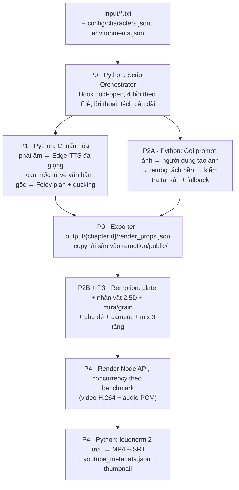

# HỆ THỐNG KẾ HOẠCH TRIỂN KHAI CINESTORY REMOTION ENGINE
### TỰ ĐỘNG CHUYỂN THỂ TRUYỆN THÀNH VIDEO ĐIỆN ẢNH TIẾT KIỆM (0 VNĐ) & CHẤT LƯỢNG CAO
*(Tham khảo remotion-cuongit-template, auto-video-gen và auto-compare-video của tác giả Cường IT)*

> **Bản sửa đổi 2 (2026-09-25).** Plan được viết lại sau khi đối chiếu với code đang có và với `_ref_sources/`. Những thay đổi chính:
> 1. Chốt kiến trúc **Hybrid**. Python giữ phần văn bản → âm thanh (phần này đã chạy và đã có test). Remotion chỉ lo dựng hình và mix âm thanh. Hai bên trao đổi qua một file hợp đồng dữ liệu duy nhất là `render_props.json`.
> 2. Bổ sung **quy trình tạo ảnh thủ công 0đ**: pipeline xuất gói prompt, người dùng tạo ảnh, script tự tách nền. Bản trước không nói ảnh lấy từ đâu.
> 3. Sửa những chỗ ghi "kế thừa" nhưng nguồn tham khảo thực ra không có, và sửa lỗi kỹ thuật trong code mẫu. Chi tiết nằm ở mục "Ghi chú sửa đổi" đầu mỗi phase.
> 4. Gate nào cũng có bước kiểm tra tự động, không chỉ dựa vào "quan sát trực quan".
>
> **Rev 2.1 (2026-09-25)** sửa các lỗi tìm ra khi rà soát plan. Chi tiết nằm ở mục "Bổ sung rev 2.1" đầu mỗi phase.
>
> - Số frame lưu dạng số nguyên.
> - Quy ước `null` thống nhất giữa Zod và Pydantic.
> - Thiết lập hình ảnh đi qua props.
> - Định nghĩa đủ các trường cho `title_card` / `end_screen`.
> - Quy tắc hạ cấp `over_shoulder`.
> - `requirements.txt` và danh sách gói npm.
> - Thư mục Foley theo nhóm, quy tắc chọn BGM.
> - Bảng stage chuẩn.
> - Thứ tự merge schema.
>
> **Rev 2.2 (2026-09-26)** là lần rà soát thứ hai, có kiểm chứng API trên gói Remotion 4.0.407 và chạy thử quy tắc trên dữ liệu thật của chương mẫu:
>
> - **Cảnh dài được tách hình, không tách câu.** Mỗi câu vẫn là một file TTS, còn hình chia thành các cảnh con phát nối tiếp cùng file audio (Phase 0 mục 3.4c).
> - **Cú pháp thẻ chú thích chung** trong `.txt`, cùng quy tắc gán bối cảnh và nhân vật trên hình (Phase 0 mục 3.4b).
> - **Sửa theo gói 4.0.407:** dùng `<Html5Audio>`, bọc `<OffthreadVideo>` bằng `<Loop>` để lặp, và ghim `tailwindcss@4.1.1`.
> - **Ảnh nhân vật bán thân:** mép dưới đặt ≥ 1,0 để giấu mép cắt. Vùng crop lấy tâm ở mặt hoặc ngực.
> - **Nhỏ hơn:**
>   - SFX mặc định theo hồi;
>   - thumbnail thu nhỏ bằng ffmpeg;
>   - bỏ timestamps khi video quá ngắn;
>   - `.gitignore` cho `public/chapters/`.

---

## 📍 HIỆN TRẠNG (2026-09-25)

| Phase | Trạng thái | Những gì đã có ở baseline Python |
| :---: | :---: | :--- |
| 0 | ⬜ Chưa bắt đầu | Có Pydantic models và `StateManager`, nhưng pipeline chưa dùng `StateManager`. Chưa có `remotion/` hay `package.json`. |
| 1 | 🟨 Đã làm 1 phần | Có Edge-TTS kèm mốc thời gian từng âm tiết (`.words.json`) và loudnorm 2 lượt. Đã có lựa chọn dịch vụ giọng đọc `--tts edge\|vbee`. Chưa có chuẩn hóa phát âm. File Foley được sinh ra nhưng **không được mix vào video**. |
| 2 | ⬜ Chưa bắt đầu | Chỉ có Ken Burns bằng FFmpeg `zoompan`, dùng 1 ảnh cho mọi cảnh. |
| 3 | ⬜ Chưa bắt đầu | — |
| 4 | ⬜ Chưa bắt đầu | Có xuất SRT, mỗi câu một dòng. |

**Baseline v0 (Python + FFmpeg, branch `fix/timing-srt-loudness`).** Bản này tiếp tục chạy song song làm đường dự phòng (`--renderer ffmpeg`) cho tới khi qua Gate 4.

- `run_pipeline.py` chạy 5 bước: tách cảnh → TTS → render clip Ken Burns → ghép → loudnorm.
- Các module: `src/story_parser.py`, `src/tts_service.py`, `src/vbee_client.py`, `src/video_composer.py`, `src/audio/mastering.py`, `src/core/models.py`.
- 32 test `unittest`, tất cả PASS (đã chạy lại ngày 2026-09-25). Gồm:
  - 15 test thời gian, SRT, loudness (`test_pipeline_timing.py`);
  - 14 test nhà cung cấp TTS (`test_tts_providers.py`);
  - 3 test model và `StateManager` (`test_phase0_contracts.py`).
- Chạy bằng `python -m unittest discover -s tests`. Máy chưa cài `pytest`.
- Repo **chưa có `requirements.txt`**. Phase 0 sẽ tạo file này (Task 0.0).

---

## 🧭 QUYẾT ĐỊNH KIẾN TRÚC ĐÃ CHỐT

| Mã | Quyết định | Lý do |
| :---: | :--- | :--- |
| **D1** | **Hybrid.** Python lo kịch bản, TTS, căn mốc từ, kế hoạch Foley, tài sản ảnh, mastering và đóng gói. Remotion lo dựng hình, mix âm thanh và render. | Không phải viết lại phần đã chạy và đã có test. Remotion chỉ làm phần nó mạnh nhất. |
| **D2** | **Ảnh tạo thủ công** bằng công cụ web miễn phí. Pipeline xuất gói prompt và tự tách nền bằng `rembg` (chạy CPU). | Giữ chi phí 0đ. Khuôn mặt nhân vật nhất quán hơn so với chạy SD 1.5 trên GTX 1650 4 GB. |
| **D3** | Dự án Remotion đặt trong thư mục con **`remotion/`**. | Tránh đụng `src/` của Python. `staticFile()` sẽ đọc từ `remotion/public/`. |
| **D4** | **`render_props.json` là hợp đồng dữ liệu duy nhất.** Pydantic (Python) và Zod (TS) cùng kiểm tra một file mẫu. | Chỉ có một nguồn sự thật. Hai bên lệch schema thì test báo ngay. |
| **D5** | **Python tính sẵn mọi thứ liên quan tới thời gian**: số frame mỗi cảnh, cụm phụ đề, mốc SFX, vùng ducking, biên độ miệng. Remotion chỉ đọc. | Phụ đề trên hình và file SRT dùng chung một dữ liệu. Render đa tiến trình luôn cho kết quả giống nhau. |
| **D6** | fps, độ phân giải và tỉ lệ khung lấy từ `config/settings.json`. Hiện tại là 1920×1080, 16:9, **24 fps**. | Bản trước ghi cứng 30 fps, lệch với config. |
| **D7** | Âm thanh chỉ được mã hóa AAC **một lần**, ở bước mastering cuối. | Bài học từ baseline: mã hóa AAC nhiều lần gây trễ tiếng (AAC priming). |

---

## 🏗️ LUỒNG DỮ LIỆU MỚI



---

## ⚖️ SO SÁNH: BASELINE V0 VS MỤC TIÊU

| Tiêu chí | Baseline v0 (Python + FFmpeg) | Mục tiêu (CineStory Hybrid) |
| :--- | :--- | :--- |
| **Công nghệ lõi** | Python + FFmpeg CLI | Python cho dữ liệu và âm thanh. **Remotion v4 + React 19 + TypeScript + Tailwind v4** cho hình. |
| **Camera** | `zoompan` tuyến tính, 1 lớp ảnh | Chuyển động có easing, parallax 2 lớp (plate + nhân vật) |
| **Nhân vật** | Một ảnh tĩnh dùng cho mọi cảnh | Nhân vật đã tách nền đặt trên plate. Có nhịp thở. Chớp mắt khi có ảnh biến thể. Miệng cử động theo biên độ giọng, chỉ ở cảnh thoại. Hoặc thay bằng clip Kling/Hedra. |
| **Phụ đề** | Chỉ có file SRT, mỗi câu một dòng | Cụm 3–6 từ bám theo mốc giọng đọc, highlight từ khóa. SRT dùng cùng dữ liệu. |
| **Phát âm** | Đọc nguyên văn số và ký hiệu | Bộ chuẩn hóa có bảng test ≥ 40 ca. `voice_text` không còn sót chữ số hay ký hiệu nào. |
| **Âm thanh** | Chỉ có giọng đọc + loudnorm | 3 tầng: giọng đọc, Foley theo mốc từ khóa, BGM có ducking. Loudness −14 LUFS. |
| **Tích hợp IDE** | Chạy lệnh thủ công | Skill `/create-story-video` cho Antigravity, kèm bản sao cho Claude Code |
| **Chi phí** | 0 VNĐ | 0 VNĐ (xem mục "Pháp lý & chi phí") |

---

## 🗂️ DANH MỤC PHASE & PHỤ THUỘC

| Phase | Kế hoạch chi tiết | Trọng tâm | Phụ thuộc | Gate chính |
| :---: | :--- | :--- | :---: | :--- |
| 0️⃣ | [`PHASE_0_REMOTION_ARCHITECTURE_AND_SCHEMAS.md`](PHASE_0_REMOTION_ARCHITECTURE_AND_SCHEMAS.md) | Hợp đồng `render_props`, dự án `remotion/`, exporter. Sửa Script Orchestrator theo RULES. Có "walking skeleton": render được video Remotion đầu tiên. | — | Video Remotion tối giản, thời lượng khớp ±1 frame |
| 1️⃣ | [`PHASE_1_PHONETIC_AUDIO_AND_FOLEY_SOUNDSCAPE.md`](PHASE_1_PHONETIC_AUDIO_AND_FOLEY_SOUNDSCAPE.md) | Chuẩn hóa phát âm, căn mốc từ, đa giọng, khoảng lặng kịch tính, kế hoạch Foley/BGM, cache TTS | 0 | Không sót chữ số. Foley đúng mốc. Phụ đề theo văn bản gốc. |
| 2️⃣ | [`PHASE_2_CINEMATIC_25D_RACCORD_SCENE_COMPONENTS.md`](PHASE_2_CINEMATIC_25D_RACCORD_SCENE_COMPONENTS.md) | **2A:** tài sản ảnh thủ công + tách nền. **2B:** component 3 lớp, camera, phụ đề, TitleCard, mix âm thanh. | 0 (2A chạy song song với P1) | Ảnh still đúng. Font tiếng Việt đúng. Render tất định. |
| 3️⃣ | [`PHASE_3_AUDIO_REACTIVE_ACTING_AND_HYBRID_SLOTS.md`](PHASE_3_AUDIO_REACTIVE_ACTING_AND_HYBRID_SLOTS.md) | Thở, chớp mắt, miệng dựa trên ảnh biến thể. Khe cắm Hybrid cho clip Kling/Hedra. | 1, 2 | Test hàm thuần, still ở khung chớp mắt, thử thả clip mẫu |
| 4️⃣ | [`PHASE_4_REMOTION_RENDER_PACKAGING_AND_ANTIGRAVITY_SKILL.md`](PHASE_4_REMOTION_RENDER_PACKAGING_AND_ANTIGRAVITY_SKILL.md) | Render đa tiến trình theo benchmark, mastering, SRT, gói YouTube, skill, test E2E | 1, 2, 3 | E2E tự động: thời lượng, loudness, SRT, thời gian render |
| 5️⃣ | [`PHASE_5_CAPCUT_DRAFT_EXPORTER_AND_TIMELINE_BRIDGE.md`](PHASE_5_CAPCUT_DRAFT_EXPORTER_AND_TIMELINE_BRIDGE.md) | Bộ xuất dự án CapCut/JianYing Desktop đa track (plates, voice, foley, bgm, text subtitles), microsecond math | 0, 1, 4 | Mở draft hợp lệ trên CapCut Desktop, thời lượng khớp microsecond |
| 6️⃣ | [`PHASE_6_TIMELINE_RELIABILITY_OTIO_AND_AI_COPILOT.md`](PHASE_6_TIMELINE_RELIABILITY_OTIO_AND_AI_COPILOT.md) | Ghi file an toàn nguyên tử (.bak), Linter quét lỗi timeline, chuẩn mở OpenTimelineIO (OTIO), lệnh `doctor` | 4, 5 | Linter bắt 100% lỗi giả lập, khôi phục sau sự cố, file .otio hợp lệ |

**Thứ tự đề xuất:** P0 → (P1 ∥ P2A) → P2B → P3 → P4.

**Luật merge khi P1 và P2A chạy song song:**

- Cả hai phase đều sửa exporter và `render_props.sample.json`. P1 điền các trường đã có sẵn trong schema; P2A thêm trường mới vào schema (Zod + Pydantic).
- Mọi phần khác chạy song song được. Riêng hai task này làm tuần tự: **Task 1.8 merge trước, Task 2.4 rebase lên sau**.

---

## 🧩 CÁC STAGE CỦA PIPELINE (`run_pipeline.py --stage`)

Đây là bảng chuẩn duy nhất. Các phase chỉ ghi mình làm stage nào.

| Stage | Loại | Công việc | Có từ |
| :--- | :---: | :--- | :---: |
| `script` | đơn | Tách cảnh, hồi, cỡ cảnh, camera, `title_card` / `end_screen` → `storyboard.json` | P0 |
| `audio` | đơn | TTS, mốc từ, tách hình cảnh dài (P0). Chuẩn hóa phát âm, captions, kế hoạch Foley/BGM (P1) | P0 (P1 mở rộng) |
| `assets` | đơn | Gói prompt ảnh, tách nền, kiểm tra tài sản, chọn `visual.mode`, hạ cấp `over_shoulder`, checklist. Chạy lại được nhiều lần; ảnh đã tách nền được cache. | P2 |
| `props` | đơn | Xuất `render_props.json` + copy tài sản vào `remotion/public/chapters/<chapterId>/` | P0 |
| `video` | đơn | Render Remotion. P0 dùng CLI; P4 dùng Node API, xuất `video.prenorm.mkv` (PCM) | P0 |
| `master` | đơn | Loudnorm 2 lượt + mux MP4, AAC 1 lần | P4 |
| `package` | đơn | SRT, `youtube_metadata.json`, `thumbnail_base.png`, hoàn thiện `render_report.json` | P4 |
| `capcut` | đơn | Xuất thư mục dự án CapCut/JianYing (`draft_content.json`, `draft_info.json`) mở trực tiếp trên CapCut Desktop | P5 |
| `prepare` | gộp | `script` → `audio` → `assets` → `props`, rồi dừng chờ người dùng tạo ảnh | P4 |
| `render` | gộp | **`assets`** → `props` → `video` → `master` → `package`. Phải chạy lại `assets` để nhận ảnh người dùng vừa thêm sau `prepare` (tách nền, chọn lại `visual.mode`). | P4 |
| `all` | gộp | Mọi stage đơn đã có, theo thứ tự trong bảng. P0: `script` → `audio` → `props` → `video`. Từ P2 có thêm `assets` trước `props`. | P0 |

`--renderer ffmpeg` (baseline) chỉ hỗ trợ `--stage all` và chỉ render các cảnh `story`.

## 📁 BỐ CỤC FILE THEO CHƯƠNG

Mọi file sinh ra trong lúc chạy đều nằm trong thư mục riêng của chương, để chạy chương B không ghi đè lên chương A (Task 4.10 chạy 2 chương):

```text
output/<chapterId>/
├── storyboard.json          # nguồn trạng thái duy nhất: stage script tạo, các stage sau cập nhật; StateManager đọc/ghi file này (có trạng thái từng cảnh)
├── audio/                   # <shot_id>.mp3|.wav + .words.json + .meta.json (cache TTS)
├── render_props.json        # stage props
├── stills/                  # contact sheet (P2), ảnh kiểm tra chớp mắt (P3)
├── render_report.json       # báo cáo lần render cả chương gần nhất (P2 tối giản, P4 bổ sung)
├── bench_<nhãn>.json        # đo hiệu năng trên một dải frame, không bị lần render sau ghi đè (vd bench_p2, bench_p3)
├── video.remotion.mp4       # P0, stage video
├── video.prenorm.mkv        # P4, stage video (xóa sau khi master thành công)
└── video.mp4 · video.srt · youtube_metadata.json · thumbnail_base.png   # P4
remotion/public/chapters/<chapterId>/   # bản sao tài sản cho Remotion (không commit)
tests/fixtures/sample_chapter/          # bản đóng băng mp3 + .words.json của chương mẫu, dùng cho test
```

- **`chapterId`** = tên file đầu vào bỏ đuôi `.txt` và bỏ hậu tố `.annotated`, bỏ dấu, chỉ giữ `[a-z0-9_]`. Nhờ vậy `sample_chapter.annotated.txt` và `sample_chapter.txt` ra cùng `sample_chapter`.
- **Audio TTS chuyển từ `assets/audio/shots/` sang `output/<chapterId>/audio/`**, áp dụng cho cả hai renderer. Các file hiện có trong `assets/audio/shots/` được chép sang `tests/fixtures/sample_chapter/` (Task 0.4), vì test không được đọc thư mục mà pipeline có thể ghi đè.
- Tham số `--output` của renderer ffmpeg giữ nguyên hành vi cũ.
- `StateManager` được khởi tạo với `state_file_path = output/<chapterId>/storyboard.json`. Không có file `pipeline_state.json` riêng, vì model `Storyboard` đã chứa trạng thái từng cảnh; hai bản sao sẽ không biết lấy bản nào khi resume.

---

## 🔁 KẾ THỪA TỪ `_ref_sources/`: CÁI GÌ CÓ, CÁI GÌ KHÔNG

| Nguồn | Có thật, nên dùng | Không có (đừng mất công đi tìm) |
| :--- | :--- | :--- |
| `remotion-cuongit-template` | `remotion.config.ts` + `@remotion/tailwind-v4`. Bộ phiên bản đã ghim: remotion 4.0.407, zod 3.22.3, React 19.2. Khung `SubtitleBox.tsx` (spring pop-in, kiểu pill). Cấu trúc `SKILL.md`. | `SubtitleBox` **chia thời gian đều** cho các cụm, không bám theo giọng đọc. Highlight chỉ khớp được **một từ đơn**. Bộ đọc MPEG header dùng bảng sample-rate MPEG-2 cho cả MPEG-1. Không port phần này; ta đo thời lượng bằng ffprobe. |
| `auto-video-gen` | Bảng quy tắc phiên âm trong `.agents/skills/create-news-video/SKILL.md`, dùng làm ca test. `src/assets/sfx-selector.ts`: chọn SFX theo 3 tầng, hash tất định. `mixSfxOntoVoice` trong `src/assets/audio-tools.ts`. Cấu trúc skill. | **Không có code** chuẩn hóa phát âm. Các quy tắc chỉ là hướng dẫn cho AI agent viết `voiceText`. Dự án dùng HyperFrames (HTML), không phải Remotion. Dùng zod 4, không khớp với bản zod mà Remotion ghim. `scripts/download-sfx.ts` tải từ myinstants.com: **không dùng** vì rủi ro bản quyền. |
| `auto-compare-video` | Ý tưởng "thở" bằng glow nhấp nhô. Miệng nhấp nháy trong khoảng thời gian đang nói. Tài liệu VieNeu TTS local (`vieneu.md`) làm phương án TTS dự phòng. | Avatar là robot SVG/CSS + GSAP, **không phải** ảnh chân dung. Miệng không theo biên độ âm thanh thật. |
| `capcut-cli` (René Zander) | Cấu trúc reverse-engineered của CapCut/JianYing Desktop (`draft_content.json`, `draft_info.json`). Quản lý timebase microsecond ($1\text{s} = 1\,000\,000\,\mu\text{s}$). Kỹ thuật ghi file an toàn nguyên tử (`atomic-write.ts`), linter timeline (`lint.ts`), chẩn đoán môi trường (`doctor.ts`), chuẩn mở OpenTimelineIO (`interchange.ts`). Python wrapper (`python/capcut`). | Là công cụ thao tác project JSON, **không tự render video độc lập** mà cần CapCut Desktop hoặc ffmpeg probe. Không có hiệu ứng 2.5D parallax hay audio envelope trực tiếp như Remotion. |

---

## 🧱 BẤT BIẾN KỸ THUẬT (PHASE NÀO CŨNG KHÔNG ĐƯỢC PHÁ)

Rút ra từ baseline v0 và các test hiện có (`tests/test_pipeline_timing.py`):

1. **Thời lượng một câu `story`** = thời lượng giọng đọc + 0,6 s đệm (hoặc `dramatic_pause_sec` ở một số cảnh), tối thiểu `shot_min_duration` (4,0 s), làm tròn **lên** theo lưới frame.
   - Python tính và lưu **số frame nguyên** (`plan_shot_frames` → `duration_frames`), không nhân ngược từ giây đã làm tròn.
   - Câu dài hơn `shot_max_duration` (6,5 s) được **tách hình** thành các cảnh con, mỗi cảnh con ≥ `split_min_duration` (2,5 s). Các cảnh con dùng chung một file audio, và tổng frame của chúng bằng đúng thời lượng câu (Phase 0 mục 3.4c).
   - Cảnh `title_card` / `end_screen` lấy thời lượng từ config.
2. **Tổng thời lượng video** = Σ `durationInFrames` / fps, sai số tối đa 1 frame. Nếu dùng chuyển cảnh chồng lấn, phần chồng lấn phải được trừ ở **cùng một hàm** cho cả video lẫn SRT.
3. **Mốc SRT** làm tròn tới mili giây, không cắt cụt. Phụ đề giữ thêm 0,3 s sau từ cuối.
4. **Loudness bản cuối**: −14 LUFS (±1), true peak ≤ −1,5 dBTP. Chỉ chuẩn hóa một lần, trên bản mix cuối.
5. **Render tất định**: cùng props thì ra cùng khung hình. Không dùng `Math.random()` hay `Date.now()` trong component.

---

## 💸 PHÁP LÝ & CHI PHÍ "0 VNĐ": CẦN BIẾT

- **Remotion** miễn phí cho cá nhân và công ty tối đa 3 người. Tổ chức lớn hơn phải mua Company License. Đọc lại điều khoản trên remotion.dev trước khi dùng thương mại.
- **Vbee** (tùy chọn `--tts vbee`) là dịch vụ **trả phí theo số ký tự**. Chọn Vbee thì video không còn 0đ. Khóa để trong `.env`, file này đã nằm trong `.gitignore`.
- **Edge-TTS** dùng endpoint không chính thức của tính năng "Read aloud" trên Microsoft Edge, có thể bị chặn bất cứ lúc nào. Vì vậy bắt buộc cache audio (P1) và có phương án dự phòng (VieNeu TTS chạy local).
- **SFX/BGM** chỉ lấy từ nguồn có giấy phép rõ ràng: CC0 trên Freesound, YouTube Audio Library, Pixabay… Ghi nguồn từng file vào `assets/audio/LICENSES.md`. Các file Foley hiện tại được tổng hợp bằng FFmpeg, chỉ dùng để chạy thử.
- **Kling/Hedra**: gói miễn phí giới hạn credit. Hybrid slot là tùy chọn, pipeline không phụ thuộc vào nó.
- **Ảnh AI**: kiểm tra điều khoản sử dụng thương mại của công cụ tạo ảnh đã chọn.

---

## 🎯 QUY TẮC TÀI NGUYÊN PHẦN CỨNG (Dual Xeon E5-2680 v4 · 64 GB RAM · GTX 1650 4 GB)

1. Remotion render từng khung hình bằng Chromium headless, gần như hoàn toàn trên **CPU**. Số tiến trình song song (`concurrency`) phải chọn bằng `npx remotion benchmark`, không ghi cứng. Kết quả lưu vào `config/settings.json → render.concurrency`.
2. GPU gần như không tham gia. Tránh các hiệu ứng CSS tốn kém khi render: `backdrop-filter: blur`, `filter: blur` bán kính lớn, nhiều lớp box-shadow lớn. Film grain dùng ảnh noise lặp lại thay vì tính từng pixel.
3. `rembg` và phân tích biên độ âm thanh chạy trên CPU, mỗi tài sản chỉ xử lý một lần (có cache).

---

## ✅ LỆNH KIỂM THỬ CHUNG

```powershell
python -m unittest discover -s tests          # Python: baseline + các phase mới
cd remotion; npm run typecheck; npm test      # TypeScript: có từ Phase 0
```
