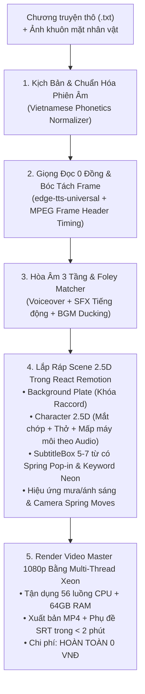

# HỆ THỐNG KẾ HOẠCH TRIỂN KHAI CINESTORY REMOTION ENGINE
### TỰ ĐỘNG CHUYỂN THỂ TRUYỆN THÀNH VIDEO ĐIỆN ẢNH TIẾT KIỆM (0 VNĐ) & CHẤT LƯỢNG CAO
*(Kế thừa tinh hoa từ remotion-cuongit-template, auto-video-gen và auto-compare-video của tác giả Cường IT)*

---

## 📌 TỔNG QUAN KIẾN TRÚC MỚI: VIDEO-AS-CODE VỚI REMOTION

Thay vì sử dụng FFmpeg thô với các câu lệnh lọc phức tạp, hệ thống chuyển dịch toàn bộ sang **Remotion v4 (React + TypeScript + TailwindCSS)** — nền tảng lập trình video bằng code mạnh mẽ nhất hiện nay:

---

## ⚖️ SO SÁNH: KIẾN TRÚC CŨ VS KIẾN TRÚC MỚI

| Tiêu chí | Bản Thử Nghiệm (FFmpeg Script) | Bản Mới (CineStory Remotion Engine) |
| :--- | :--- | :--- |
| **Công nghệ Lõi** | Python + FFmpeg CLI | **Remotion v4 + React 19 + TypeScript + TailwindCSS** |
| **Chuyển động Camera** | Zoompan thô, dễ giật khung hình | **React Spring Physics & Interpolate** mượt mà chuẩn điện ảnh |
| **Diễn xuất Nhân vật** | Ảnh tĩnh 100% | **Diễn xuất 2.5D Audio-Reactive:** Mắt chớp loop, nhịp thở scaleY, cơ mặt rung theo sóng âm thanh |
| **Phụ đề (Captions)** | SRT thô / Text tĩnh che mặt | **SubtitleBox pill-box 5–7 từ/lần**, Spring Pop-in, Highlight từ khóa neon |
| **Phát âm Tiếng Việt** | Dễ vấp số và ký hiệu đặc biệt | **Bộ lọc Phonetic Normalization** đọc chuẩn 100% tiếng Việt |
| **Tích hợp IDE** | Chạy lệnh Terminal thủ công | **Tích hợp Antigravity Skill:** Gõ `/create-story-video` là AI tự làm từ A-Z |
| **Chi phí Sản xuất** | 0 VNĐ (nhưng thiếu chuyển động) | **0 VNĐ (nhưng có đầy đủ chuyển động 2.5D & âm thanh 3 tầng)** |

---

## 🗂️ DANH MỤC 5 KẾ HOẠCH PHASE CHI TIẾT

| Phase | Kế Hoạch Chi Tiết | Trọng Tâm Kỹ Thuật | Chi Phí |
| :---: | :--- | :--- | :---: |
| 0️⃣ | **[`PHASE_0_REMOTION_ARCHITECTURE_AND_SCHEMAS.md`](PHASE_0_REMOTION_ARCHITECTURE_AND_SCHEMAS.md)** | Khởi tạo dự án Remotion v4, TypeScript, Zod Data Contracts, cấu hình Multi-thread render. | **0 VNĐ** |
| 1️⃣ | **[`PHASE_1_PHONETIC_AUDIO_AND_FOLEY_SOUNDSCAPE.md`](PHASE_1_PHONETIC_AUDIO_AND_FOLEY_SOUNDSCAPE.md)** | Bộ chuẩn hóa phát âm tiếng Việt, `edge-tts-universal`, bóc tách frame chính xác từ MPEG header, thư viện SFX Foley. | **0 VNĐ** |
| 2️⃣ | **[`PHASE_2_CINEMATIC_25D_RACCORD_SCENE_COMPONENTS.md`](PHASE_2_CINEMATIC_25D_RACCORD_SCENE_COMPONENTS.md)** | Bộ React Component Remotion: Background Plate khóa Raccord, hiệu ứng mưa rơi Canvas, ánh sáng điện ảnh, SubtitleBox 5–7 từ. | **0 VNĐ** |
| 3️⃣ | **[`PHASE_3_AUDIO_REACTIVE_ACTING_AND_HYBRID_SLOTS.md`](PHASE_3_AUDIO_REACTIVE_ACTING_AND_HYBRID_SLOTS.md)** | Diễn xuất 2.5D: Mắt chớp, nhịp thở, mấp máy môi theo Audio Waveform + Khe cắm mở rộng clip Kling (Hybrid Mode). | **0 VNĐ** |
| 4️⃣ | **[`PHASE_4_REMOTION_RENDER_PACKAGING_AND_ANTIGRAVITY_SKILL.md`](PHASE_4_REMOTION_RENDER_PACKAGING_AND_ANTIGRAVITY_SKILL.md)** | CLI Render 1080p đa luồng, xuất file phụ đề SRT, đóng gói YouTube Hook và cài đặt Native Skill cho Google Antigravity IDE. | **0 VNĐ** |

---

## 🎯 QUY TẮC BẢO TOÀN TÀI NGUYÊN (HARDWARE GOVERNANCE)
1. **Tận dụng CPU Xeon 56 luồng + 64GB RAM:** Remotion render bằng Chromium headless chạy song song đa tiến trình (`--concurrency`), tận dụng toàn bộ sức mạnh CPU Xeon để render video 1080p cực nhanh.
2. **Không gây quá tải GPU GTX 1650 4GB:** Toàn bộ hiệu ứng thị giác (Parallax, Spring, Canvas) được tính toán bằng GPU WebGL / CPU Canvas nhẹ nhàng, không tiêu tốn quá 1GB VRAM, tuyệt đối không bị lỗi `Out of Memory`.
